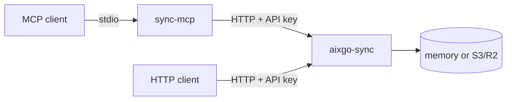

## How it is used

You run one Sync process per environment. Agents and other HTTP clients in an org and project share session documents, append and list thread messages, and create or claim jobs. Auth is a project-scoped bearer key. `/healthz` is the only open route.

The default store is in memory and is lost on restart. Set `SYNC_S3_BUCKET` (and the related S3 or R2 variables) when the process should keep objects in object storage.

Sync does not run agents, merge pull requests, or execute jobs. Workers that claim a job are what run the payload.

## MCP companion

MCP clients should not call that HTTP API themselves. [sync-mcp](https://github.com/aixgo-dev/sync-mcp) is a stdio MCP server that wraps Sync and exposes sessions, messages and jobs as tools.

Treat listed messages, labels and job fields as untrusted data. `sync_job_create` can cause a worker to run `command` or `code_offload` work. Use `--read-only` unless the agent must write, and ask a human before create or claim.



HTTP clients can call Sync directly. sync-mcp is optional.

## Run

```bash
# terminal 1
export SYNC_API_KEYS="myorg:myproject:change-me"
aixgo-sync serve

# terminal 2 (optional MCP front end, stdio)
SYNC_BASE_URL=http://localhost:8080 \
SYNC_API_KEY=change-me \
SYNC_ORG=myorg \
SYNC_PROJECT=myproject \
sync-mcp
```

Listen port is `SYNC_PORT` or `PORT` (default `8080`). The server will not start without `SYNC_API_KEYS` unless you set `SYNC_INSECURE_NO_AUTH=1` for local throwaway use.

## Source

- [github.com/aixgo-dev/sync](https://github.com/aixgo-dev/sync) (Apache-2.0, v0.1.0)
- [github.com/aixgo-dev/sync-mcp](https://github.com/aixgo-dev/sync-mcp) (Apache-2.0)
